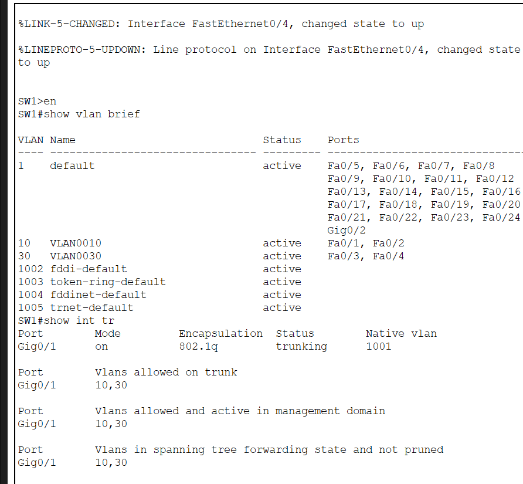
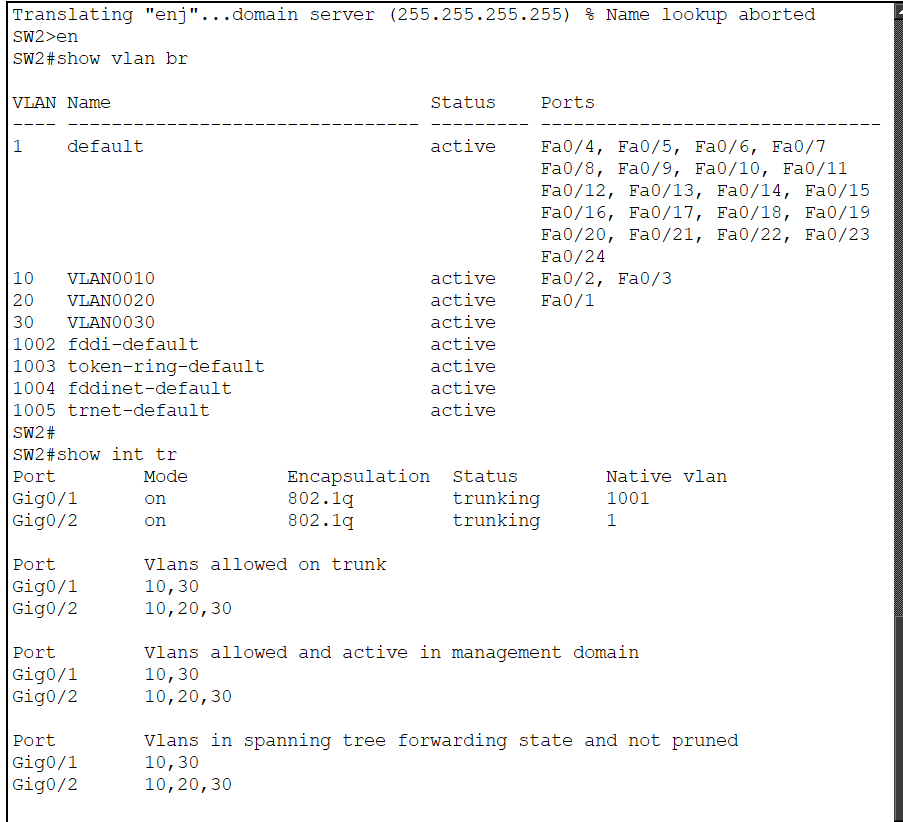
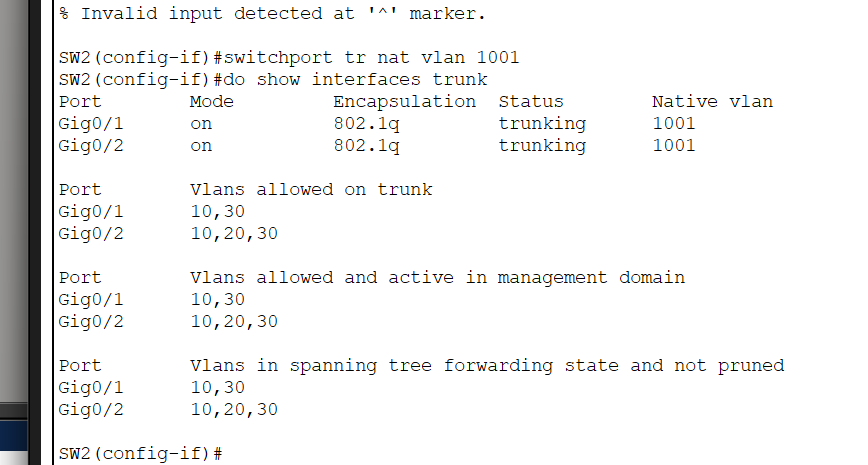
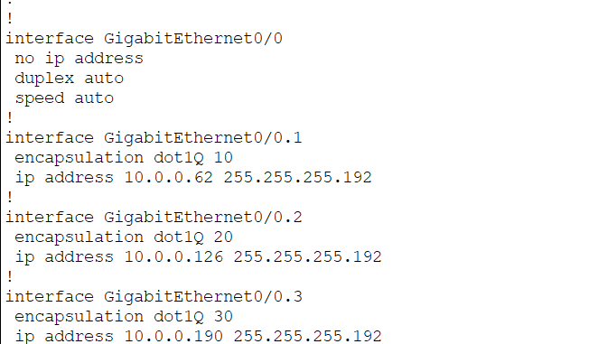
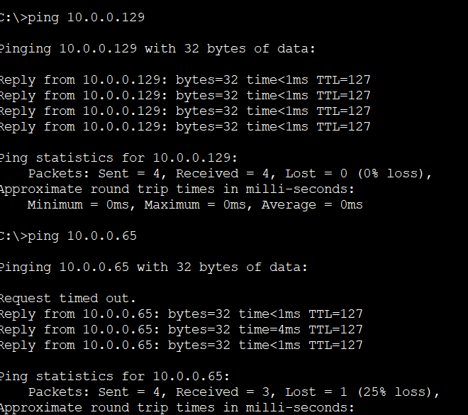

# Lab 02 — VLANs, 802.1Q Trunking and Router-on-a-Stick

**Environment:** Cisco Packet Tracer (simulated Cisco switches and router)  
**Exercise source:** Jeremy's IT Lab — VLANs (Part 2) practice exercise  
**Status:** Access-port VLANs, trunk operation and native VLAN, router subinterfaces, and tested inter-VLAN paths verified. Remaining work: verify VLAN 1001 creation in both switch databases and test all PC-to-PC paths.  

## Objective

Use three VLANs across two switches. Configure access ports and restricted 802.1Q trunks, then use R1 router subinterfaces to provide gateways for each `/26` subnet. Test communication between different VLANs.

I completed this guided CCNA practice lab and used CLI commands and Packet Tracer pings to check the configuration. The topology and original objectives come from the exercise, not an independently designed production network.

## Logical topology

```text
 PC1 / PC2 -- VLAN 10 -- SW1 ==== trunk ==== SW2 -- VLAN 10 -- PC6 / PC7
 PC3 / PC4 -- VLAN 30 --  |                  | -- VLAN 20 -- PC5
                                               |
                                          802.1Q trunk
                                               |
                                    R1 GigabitEthernet0/0
                                    |-- G0/0.1  VLAN 10
                                    |-- G0/0.2  VLAN 20
                                    `-- G0/0.3  VLAN 30
```

`====` indicates the inter-switch trunk. This is a conceptual diagram and does not imply all hosts were individually tested.

| VLAN | Network | Sample devices | Router gateway (last usable address) |
| --- | --- | --- | --- |
| 10 | `10.0.0.0/26` | PC1, PC2, PC6, PC7 | `10.0.0.62/26` |
| 20 | `10.0.0.64/26` | PC5 | `10.0.0.126/26` |
| 30 | `10.0.0.128/26` | PC3, PC4 | `10.0.0.190/26` |

## Switch configuration verification

Using `show vlan brief`, I checked the access-port memberships:

| Switch | VLAN | Access ports shown |
| --- | --- | --- |
| SW1 | 10 | `Fa0/1`, `Fa0/2` |
| SW1 | 30 | `Fa0/3`, `Fa0/4` |
| SW2 | 10 | `Fa0/2`, `Fa0/3` |
| SW2 | 20 | `Fa0/1` |

Using `show interfaces trunk`, I observed:

| Switch / interface | Operational state | Allowed VLANs | Native VLAN (latest verification) |
| --- | --- | --- | --- |
| SW1 `Gi0/1` (to SW2) | Trunking, 802.1Q | 10, 30 | 1001 |
| SW2 `Gi0/1` (to SW1) | Trunking, 802.1Q | 10, 30 | 1001 |
| SW2 `Gi0/2` (to R1) | Trunking, 802.1Q | 10, 20, 30 | **1001 — corrected and verified** |

The inter-switch trunk has matching native VLAN 1001 at both ends. An earlier screenshot showed SW2 `Gi0/2` (the router-facing trunk) using native VLAN 1, which did not meet the exercise requirement for an unused native VLAN. I updated its native VLAN configuration and verified with `do show interfaces trunk` that **both SW2 trunks now use native VLAN 1001**; the expected allowed VLANs appear in the forwarding lists. The screenshots do not confirm that VLAN 1001 has been created in each switch's VLAN database, so that remains a follow-up check.







## Router-on-a-stick verification

`show running-config` on R1 showed the following configuration (excerpt transcribed from the lab screenshot):

```cisco
interface GigabitEthernet0/0
 no ip address
!
interface GigabitEthernet0/0.1
 encapsulation dot1Q 10
 ip address 10.0.0.62 255.255.255.192
!
interface GigabitEthernet0/0.2
 encapsulation dot1Q 20
 ip address 10.0.0.126 255.255.255.192
!
interface GigabitEthernet0/0.3
 encapsulation dot1Q 30
 ip address 10.0.0.190 255.255.255.192
```

A prior `show ip interface brief` screenshot showed the three subinterfaces `up/up`. The configured VLAN tags and IP addresses correspond to the three `/26` networks.



## Connectivity tests

I tested pings from PC1 on VLAN 10:

| Source and destination | Observation | What it supports |
| --- | --- | --- |
| PC1 to PC3 (`10.0.0.129`, VLAN 30) | 3/4 replies on first test, then 4/4 on repeat | VLAN 10 to VLAN 30 connectivity works for this path |
| PC1 to PC5 (`10.0.0.65`, VLAN 20) | 3/4 replies; first request timed out | VLAN 10 to VLAN 20 connectivity works for this path |

The first-request timeout is consistent with initial ARP resolution, but these screenshots do not prove ARP was the cause. A repeated successful ping to VLAN 30 showed 0% loss. These results do **not** establish that every possible PC-to-PC path passed.



## Concepts practiced

- Assigning switch access ports to VLANs
- Restricting allowed VLANs on 802.1Q trunks
- Using an unused native VLAN on a trunk and checking for mismatches
- Calculating the last usable IP address in `/26` subnets
- Configuring router subinterfaces with `encapsulation dot1Q`
- Validating results with `show vlan brief`, `show interfaces trunk`, `show ip interface brief`, `show running-config`, and `ping`

## Follow-up checks

- [x] Correct SW2 `Gi0/2` native VLAN to 1001 and verify with `show interfaces trunk`.
- [ ] Verify whether the intended unused native VLAN was created on both switches.
- [ ] Run connectivity tests between all relevant pairs of PCs, including across switches within VLAN 10.
- [ ] Save a brief configuration explanation in my own words and independently recreate a small variation of the lab.

## Attribution and scope

This is **my verification and documentation of a guided exercise** based on Jeremy's IT Lab material. The original instructor-provided `.pkt` exercise file is not included. The images are cropped from my Packet Tracer session to focus on observed CLI output and tests. This is a simulation, not a production deployment.
