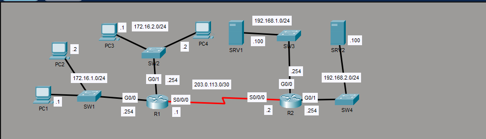
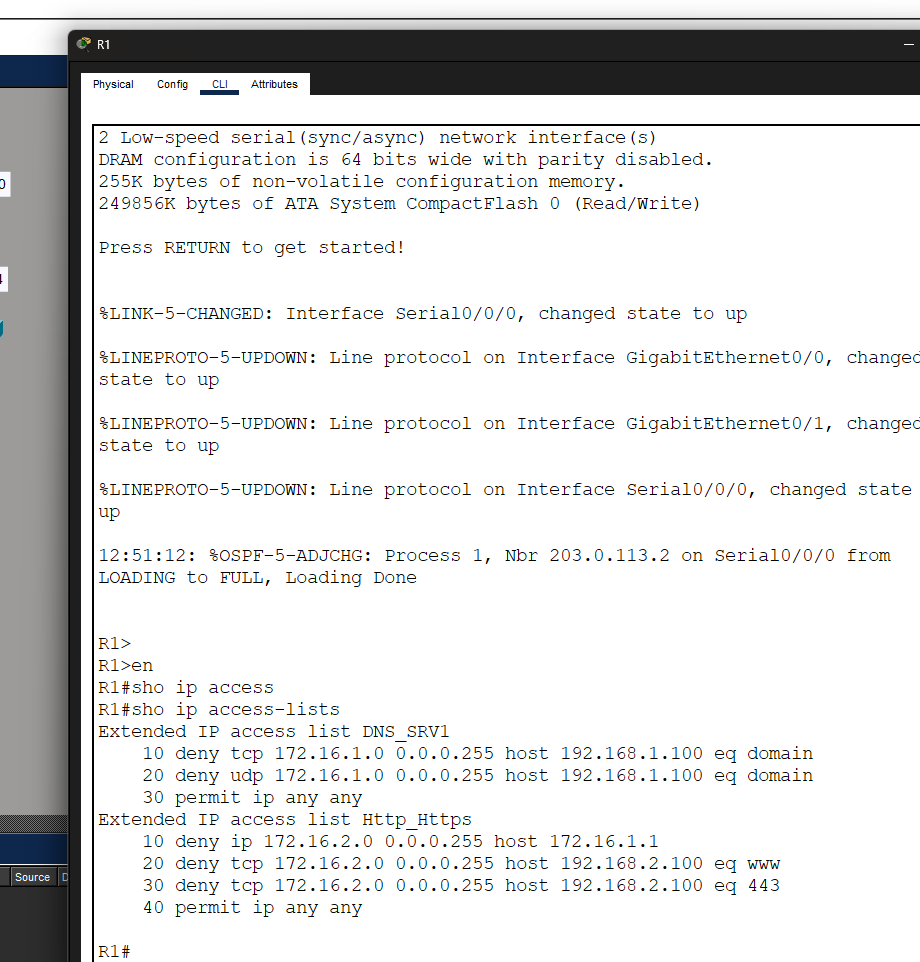
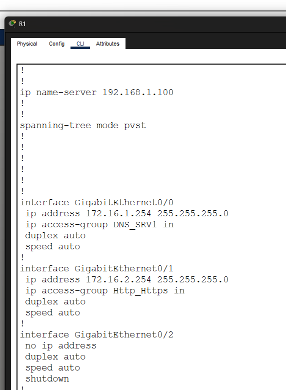
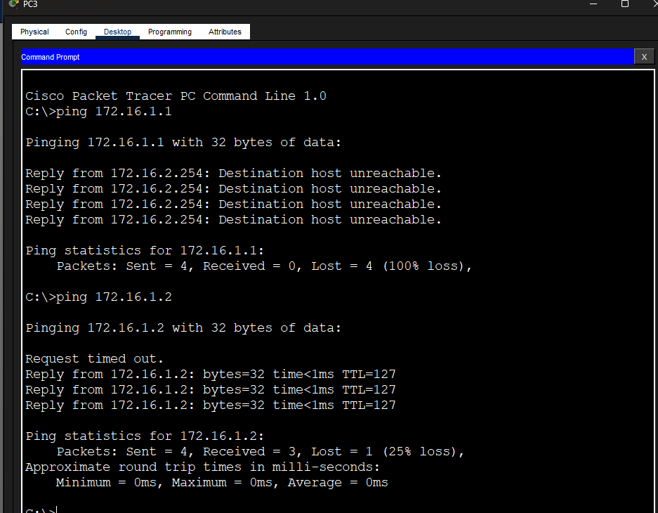
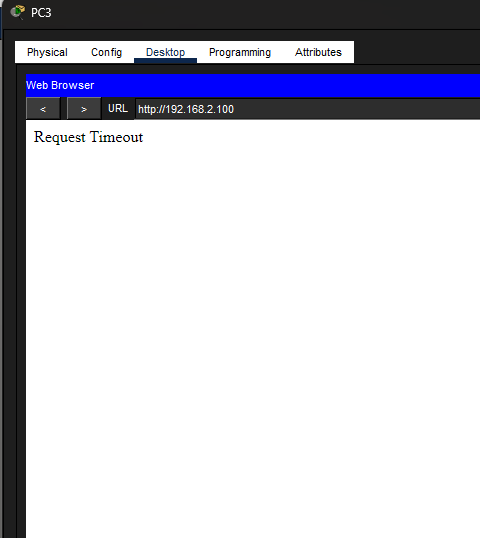
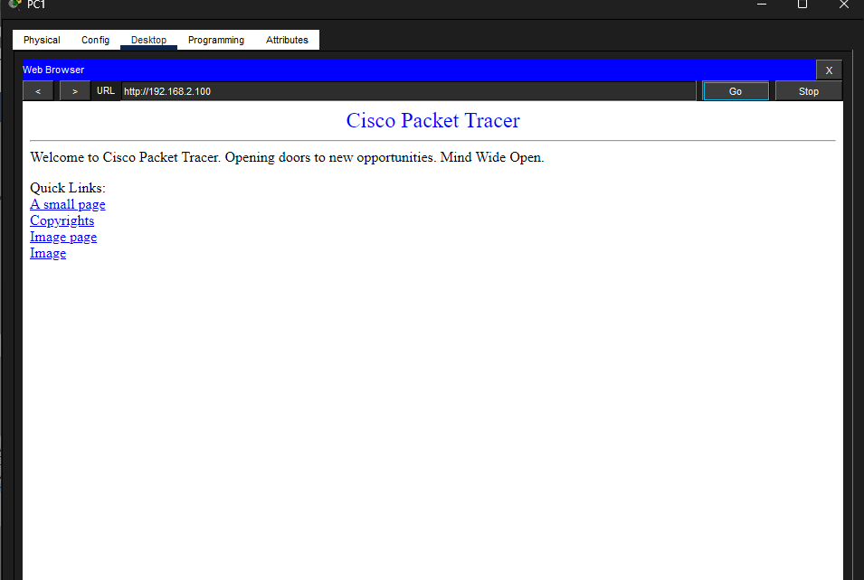
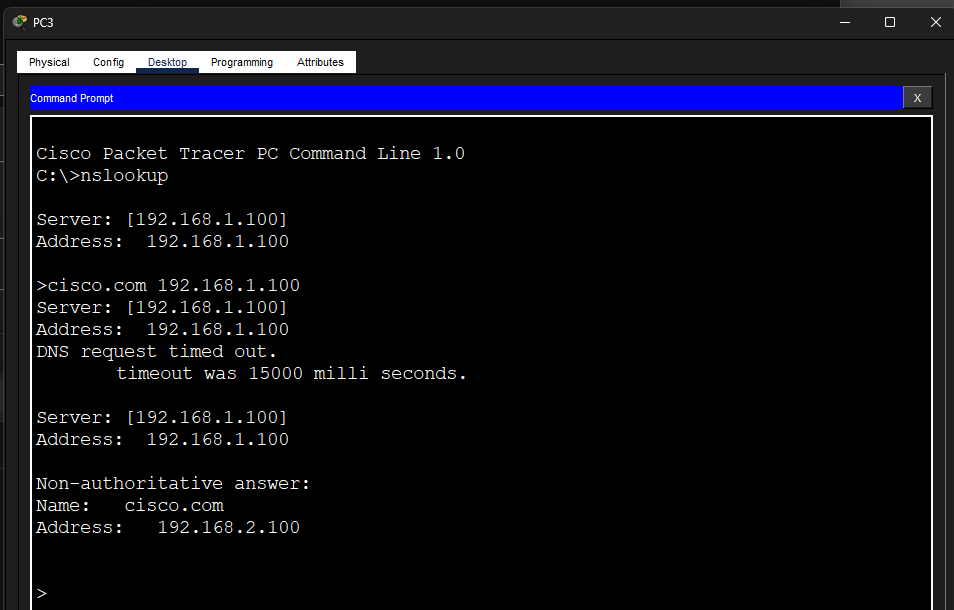
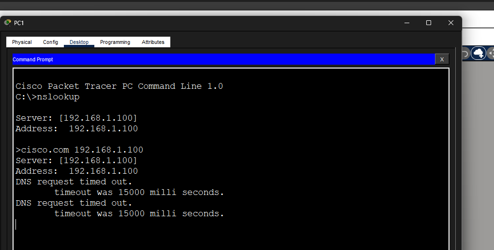

# Lab 03 — Extended ACLs: Selective Host, DNS and Web Filtering

**Platform:** Cisco Packet Tracer (simulation)  
**Scope:** Extended IPv4 ACLs, source/destination filtering, DNS (TCP/UDP 53), HTTP (TCP 80), and HTTPS (TCP 443)  
**Status:** ACL definitions, interface placement, and selected blocked/allowed paths verified; HTTPS and full policy coverage not yet tested.  
**Attribution:** Guided CCNA practice topology and objectives supplied by an instructor; exact exercise author to be confirmed. This is not an independently designed production network.

## Goal

Configure extended ACLs to enforce three policies without unnecessarily blocking unrelated traffic:

1. Block `172.16.2.0/24` from reaching **PC1** (`172.16.1.1`).
2. Block `172.16.1.0/24` from using **SRV1 DNS** (`192.168.1.100`) on TCP and UDP port 53.
3. Block `172.16.2.0/24` from using **SRV2 HTTP/HTTPS** (`192.168.2.100`) on TCP ports 80 and 443.

This project documents a guided Packet Tracer exercise that I configured and tested, then reviewed using Cisco IOS show commands and PC-side tests. It demonstrates my learning and verification process, not a claim of independently architecting a production network.

## Topology



| Segment | Devices | IP network |
| --- | --- | --- |
| R1 client LAN 1 | PC1 `.1`, PC2 `.2`; R1 gateway `.254` | `172.16.1.0/24` |
| R1 client LAN 2 | PC3 `.1`, PC4 `.2`; R1 gateway `.254` | `172.16.2.0/24` |
| R1 to R2 serial link | R1 `.1`, R2 `.2` | `203.0.113.0/30` |
| R2 server LAN 1 | SRV1 DNS `.100` | `192.168.1.0/24` |
| R2 server LAN 2 | SRV2 HTTP `.100` | `192.168.2.0/24` |

*Diagram is cropped from the practice exercise. The addresses are simulation-only; `203.0.113.0/24` is reserved for documentation.*

## ACL configuration observed on R1

These definitions were transcribed from R1's `show ip access-lists` and `show running-config` screenshots.

```cisco
ip access-list extended DNS_SRV1
 deny tcp 172.16.1.0 0.0.0.255 host 192.168.1.100 eq domain
 deny udp 172.16.1.0 0.0.0.255 host 192.168.1.100 eq domain
 permit ip any any
!
ip access-list extended Http_Https
 deny ip 172.16.2.0 0.0.0.255 host 172.16.1.1
 deny tcp 172.16.2.0 0.0.0.255 host 192.168.2.100 eq www
 deny tcp 172.16.2.0 0.0.0.255 host 192.168.2.100 eq 443
 permit ip any any
```

**Interface placement:**

```cisco
interface GigabitEthernet0/0
 ip access-group DNS_SRV1 in
!
interface GigabitEthernet0/1
 ip access-group Http_Https in
```

Both ACLs are applied **inbound**, close to the client subnet they restrict. The explicit `permit ip any any` statements allow packets that do not match the deny entries; otherwise the ACLs would end in an implicit deny.





## Verification: blocked and permitted traffic

| Policy / test | Observation | Interpretation |
| --- | --- | --- |
| PC3 `172.16.2.1` → PC1 `172.16.1.1` ping | Four `Destination host unreachable` responses from R1 (`172.16.2.254`) | **Blocked**, consistent with the host-specific deny |
| PC3 → PC2 `172.16.1.2` ping | Three replies out of four; first timed out | **Permitted** to another host on the same target subnet |
| PC3 → SRV2 `http://192.168.2.100` | Browser displayed `Request Timeout` | **Blocked / timed out**, consistent with HTTP deny |
| PC1 → SRV2 `http://192.168.2.100` | Cisco Packet Tracer webpage loaded | **Permitted** control; SRV2 HTTP service was reachable |
| PC1 → SRV1 DNS, query for `cisco.com` | Repeated DNS request timeouts | **Blocked / timed out**, consistent with DNS deny |
| PC3 → SRV1 DNS, query for `cisco.com` | Returned `192.168.2.100` following an initial timeout | **Permitted** control; SRV1 responded to the DNS request |

The paired allowed and denied tests are stronger evidence than failed requests alone: they show the destination service responded to a permitted source while the restricted source timed out.

The DNS result is a **lab DNS record**, not evidence of public internet DNS resolution. The initial failures on some permitted tests may reflect Packet Tracer startup or address-resolution behavior, but that cause was not independently measured.

### Host restriction (PC3 blocked, PC2 still reachable)



### Web restriction (PC3 blocked, PC1 permitted)





### DNS restriction (PC1 blocked, PC3 permitted)





## Skills practiced

- Extended ACL syntax using source network, destination host, protocol, and service port
- Wildcard masks and named ACLs
- Inbound interface placement and rule order
- Difference between host-level IP deny and application-specific deny
- Verifying intended restrictions with **both negative and positive controls**
- Interpreting router and client command output instead of assuming the config works

## Remaining verification

- [ ] Test HTTPS (TCP 443) explicitly from a denied and permitted client, confirming that SRV2's HTTPS service is enabled.
- [ ] Repeat policy tests from PC2 and PC4 to cover the rest of the source subnets.
- [ ] Optionally inspect ACL match counters or Packet Tracer simulation flows to corroborate the reason for denied packets.
- [ ] Add an independent extension to the exercise and document the reasoning behind it.

## Attribution and evidence scope

This is my documentation of **guided CCNA practice**, using my own Packet Tracer CLI and browser test screenshots. The exercise topology and objectives are instructor-provided; the original `.pkt` file is not redistributed. The screenshots are cropped for clarity and to omit the exercise instruction panel. **An earlier `example.com` DNS screenshot has intentionally been excluded.**

The demonstrated paths above are verified; HTTPS enforcement and exhaustive subnet coverage have **not** been claimed as completed.
