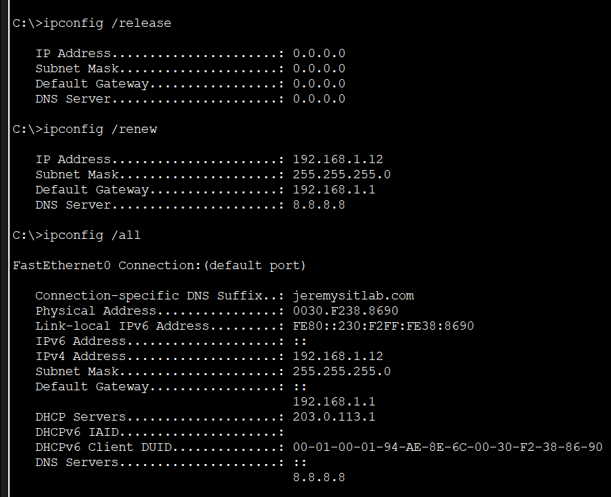

# Lab 01 — DHCP Server and Relay Across Routed Networks

**Technology:** Cisco Packet Tracer  
**Topic:** DHCP server, DHCP client interface, DHCP relay, multiple subnets  
**Status:** DHCP assignment verified; further connectivity tests planned  
**Exercise attribution:** Jeremy's IT Lab (instructor-provided CCNA practice topology and objectives). This write-up covers my work on the exercise; it is not an original network design.

## Objective

Configure a DHCP service on **R2** to assign addresses across three networks. Use **R1** as a DHCP client on its R2-facing interface and as a relay for a separate client subnet. Validate assigned client settings.

## Lab topology (simplified)

```text
PC2 -- SW2 -- R2 G0/1          R2 G0/0 -- R1 G0/0         R1 G0/1 -- SW1 -- PC1
     192.168.2.0/24                     203.0.113.0/30          192.168.1.0/24
      R2: 192.168.2.1     R2: 203.0.113.1   R1: DHCP client     R1: 192.168.1.1
                            ^ DHCP server             ^ relay for PC1
```

The two LANs are separated by routers. A client DHCP broadcast on PC1's LAN cannot travel directly to the server on R2. R1 must relay the DHCP request to the server's address for the client to receive a lease.

## DHCP pools from the exercise

| Pool/network | Gateway | Reserved addresses | DNS | Domain suffix |
| --- | --- | --- | --- | --- |
| `192.168.1.0/24` | R1: `192.168.1.1` | `.1`–`.10` | `8.8.8.8` | `jeremysitlab.com` |
| `192.168.2.0/24` | R2: `192.168.2.1` | `.1`–`.10` | `8.8.8.8` | `jeremysitlab.com` |
| `203.0.113.0/30` | Point-to-point link | `.1` | Not specified | Not specified |

`203.0.113.0/24` is an address block reserved for documentation; the exercise uses a `/30` subnet within it.

## Verification evidence

### R2 DHCP bindings

The `show ip dhcp binding` output observed on R2 listed three automatic leases:

| Client | Leased IPv4 address |
| --- | --- |
| PC1 on R1 LAN | `192.168.1.12` |
| PC2 on R2 LAN | `192.168.2.11` |
| R1 G0/0 (R2-facing interface) | `203.0.113.2` |

These match the expected address ranges and exclusions. They show that the DHCP service issued leases to three different networks. The actual device configuration commands have not yet been included in this repository.

### PC1 renewal and client settings

On PC1, I used Packet Tracer's command prompt to release and renew its address, then ran `ipconfig /all`.

| Setting | Observed on PC1 |
| --- | --- |
| IPv4 address | `192.168.1.12` |
| Subnet mask | `255.255.255.0` |
| Default gateway | `192.168.1.1` |
| DHCP server | `203.0.113.1` |
| DNS server | `8.8.8.8` |
| DNS suffix | `jeremysitlab.com` |



**Interpretation:** PC1 received its lease and expected DHCP options from a server across the routed link. This is consistent with DHCP relay functioning. A later revision will include `show running-config` excerpts on R1/R2 and packet-level validation of the relay.

## What I learned

- DHCP broadcasts normally remain on their local broadcast domain; relay makes centralized DHCP possible across routed networks.
- A Cisco router can be a DHCP client on one interface while serving as the default gateway and relay for a different subnet.
- Checking both `show ip dhcp binding` and `ipconfig /all` verifies the server-side lease and client-side configuration.
- An assigned DNS address is **not** proof that DNS queries resolve; additional connectivity testing is needed.

## Next steps

- [ ] Capture the DHCP pool and relay configuration from R2 and R1 (reviewed and sanitized).
- [ ] Verify PC2's client options with `ipconfig /all`.
- [ ] Test client reachability to default gateway and across routers with `ping`.
- [ ] Make a small independent variation (e.g., additional excluded addresses), predict and verify the effect.

## Attribution and sharing

This is documentation of a **guided CCNA study exercise** from Jeremy's IT Lab, not a claim of independent network architecture or a production implementation. The instructor's original `.pkt` file is not included. The included validation screenshot is cropped from my own Packet Tracer session to show test results rather than reproducing the assignment instructions.
